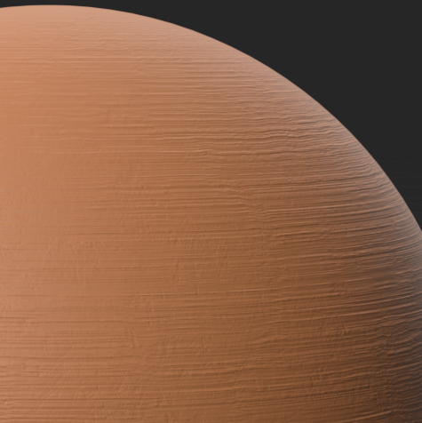

# Holzschliff

<table>
  <tr style="border: 0;">
    <td style="border: 0;" valign="top"> <strong>In:</strong> Verschleiß und Ende</td>
    <td style="border: 0;" valign="top">Beschreibung Fügen Sie Ihrem Material Normal- und Holzdetails hinzu, um Oberflächen hinzuzufügen, die im Allgemeinen mit Rauheiten wie Lack, Ceruse oder Holzfaser verknüpft sind. <em>Eine einfache Füllfarbe</em><strong><em> </em></strong><em>erhält das Aussehen von Holz, indem Holzfaser mit dem </em><strong><em>Holzfinishfilter</em></strong><em>.</em>  hinzugefügt wird</td>
  </tr>
</table>

## Parameter

**Basisparameter**

* **Zufallsparameter**:

  Der Zufallswert bestimmt die Zufallswerte anderer Parameter, die den Zufallswert in diesem Filter verwenden.

* **Typ abschließen**:

  Wählen Sie einen Stil aus, der auf Ihr Metall angewendet werden soll. Jeder Stil verfügt über verschiedene Parameter, mit denen du sein Erscheinungsbild anpassen kannst. Außer dem **Natural**-Finish verfügt jedes Finish über einen Satz von Parametern, die den Effekt steuern.

  Die folgenden Ausführungen sind verfügbar:

  * **Natural**: Ein glattes natürliches Finish für verarbeitetes Holz.
  * **Ceruse**: Durch die Einfärbung offener Poren mit Pigmenten verleihst du deinem Bild einen weichen, zweifarbigen Look.
  * **Matte Varnish**: Füge einen matten Lack hinzu.
  * **Varnish**: Mit einem reflektierenden Lack versehen.
  * **Alt**: Passe die Farbe und Rauheit des darunter liegenden Materials an, um das Aussehen von gealtertem Holz zu verändern.
  * **Raw**: Fügen Sie Holzfaser hinzu, um das Aussehen von rohem Schnittholz zu erzeugen.
  * **Gesägt**: Fügen Sie Sägebahnen hinzu, um das Aussehen von Holz frisch aus dem Holzwerk zu erzeugen.

### Freigegebene Parameter

Die folgenden Parameter werden bei mehreren Ausführungen angezeigt:

* **Farbton**: Passen Sie die Farbe des Materials an.
* **Sättigung**: Passe die Stärke der Farben an.
* **Luminanz**: Passe die Helligkeit an.
* **Intensität der Rauheit**: Passen Sie die Rauheit des Materials an.
* **Intensität der Rauheit der Fasern**: Fügt der Rauheit-Map Informationen zur hochfrequenten Rauheit hinzu. In Kombination mit dem Regler &quot;Intensität der Rauheit&quot; können Sie die Werte für die Rauheit ändern, unabhängig davon, ob das Material sehr glatt oder sehr rau ist.
* **Normalintensität**: Passen Sie die Stärke der Normalen-Map an.
* **Fasermaskenkontrast**:

### Fertigstellung

#### Ceruse

* **Farbe 1**:
* **Farbe 2**:
* **Variationen der Grundfarbe**:
* **Hochfrequenzdetails**:

#### Lack

* **Orientierungsvarianten für normale Fasern**:

#### Alt

* **Farbintensität der Rauheit beschönigen**:
* **Effektdrehung**:

#### Raw

* **Normale zusätzliche Informationen**:

#### gesägt

* **Reduzierung der Rauheit mit Fasern**: Passen Sie die Rauheit entlang der Sägelinien an, um einen Kontrast der Rauheit zu erzielen.
* **Saw-Cuts-Nummer**: Passen Sie die Anzahl der Sägelinien an.
* **Regelmäßigkeit der Maske**: Passen Sie an, wie regelmäßig die Sägelinien angezeigt werden. Je höher der Wert, desto unregelmäßiger werden die Zeilen.
* **Zusätzliche Fasern**: Passen Sie die Anzahl der Fasern an, die parallel zu den Sägelinien hinzugefügt werden.
