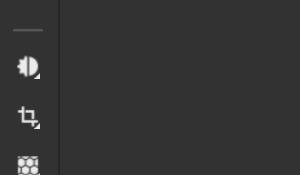

# Seitenleisten

Sampler hat zwei Seitenleisten, die **linke Seitenleiste** und die **rechte Seitenleiste**.

## Linke Seitenleiste

Von der **linken Seitenleiste** aus können Sie:

* **Inhalt hinzufügen und importieren**: Importiere Bilder, und lege fest, wie sie in dein Projekt integriert werden sollen.
* **3D-Assets durchsuchen**: Greifen Sie innerhalb von Creative Cloud Desktop auf Tausende von Materials von Substance 3D Assets zu.
* Auf **Schnellaktionen** zugreifen: Eine Sammlung von Maßnahmen, um bestimmte Ziele schnell zu erreichen. [Weitere Informationen zu **Schnellaktionen &#x200B;**](../features-and-workflows/quick-actions.md)**.**
* Schneller Zugriff auf Filter.
* Öffnen Sie die folgenden Fenster erneut, wenn sie geschlossen sind:
  * Der Bereich &quot;**Schnellaktionen&quot;**.
  * Das **Projektfenster**.
  * Das **Bedienfeld &quot;Elemente&quot;**.
  * Der Bereich &quot;**Kanaleinstellungen&quot;**.

Weitere Informationen zu den in der **linken Seitenleiste** verfügbaren Filtern finden Sie unter [Tools und Widgets](tools-and-widgets/tools-and-widgets.md).

## Rechte Seitenleiste

Die **rechte Seitenleiste** enthält die folgenden Fenster, wenn sie geschlossen sind:

* Das **Ebenenbedienfeld**.
* Der Bereich &quot;**Eigenschaften&quot;**.
* Die **Bedienfeld „Veröffentlichte Parameter“**.
* Das **Bedienfeld für Physische Größen**.
* Das **Metadatenbedienfeld**.
* Das **Exportbedienfeld**.

## Filter über die Seitenleiste hinzufügen

Die **linke Seitenleiste** bietet schnellen Zugriff auf Filter. Wenn du den Cursor über ein Filtersymbol bewegst, wird der Filtername angezeigt. Wenn du auf einen Filter klickst, wird der Name sofort zu deinem Stapel hinzugefügt.

Sie können auch mit der rechten Maustaste auf einen Filter klicken, um eine Liste der zugehörigen Filter anzuzeigen. Klicken Sie z. B. mit der rechten Maustaste auf den Filter **Kachelung**, und Sie können auf die Filter **Automatische Kachelung** und **Kachel erstellen** zugreifen.

>[!NOTE]
>
> Wenn Sie das **Kontextmenü** zum Hinzufügen eines Filters verwenden, wird der ursprüngliche Filter in der **Seitenleiste** durch den zuletzt verwendeten Filter ersetzt.
>
> In der Animation unten wird beispielsweise der **Filter zum Ausgleichen** angezeigt. Nachdem Sie mit der rechten Maustaste geklickt und den **Filter zum Entfernen von Falten** hinzugefügt haben, wird der **Filter zum Ausgleichen** in der **Seitenleiste** durch den **Filter zum Entfernen von Falten** ersetzt.
>
> 

Die folgenden Filter können von der **Seitenleiste** hinzugefügt werden:

<table>
  <tr style="border: 0;">
    <td style="border: 0;" valign="top"><ul><li><a href="../filters/adjustments/equalize.md">Tonwertangleichung</a><ul><li><a href="../filters/adjustments/fold-remover.md">Faltenentferner</a></li></ul></li><li><a href="../filters/tools/crop-tool.md">Freistellungswerkzeug</a><ul><li><a href="../filters/tools/perspective-correction.md">Perspektivkorrektur</a></li></ul></li><li><a href="../filters/tools/tiling.md">Kacheln</a><ul><li><a href="../filters/tools/auto-tiling.md">Automatische Kachelung</a></li><li><a href="../filters/tools/make-it-tile.md">Anordnen.</a></li></ul></li><li><a href="../filters/tools/transform.md">Transformieren</a><ul><li><a href="../filters/tools/warp.md">Verformen</a></li><li><a href="../filters/tools/warp-transform.md">Transformieren Verkrümmen</a></li><li><a href="../filters/tools/perspective-correction.md">Perspektive Transformieren</a></li><li><a href="../filters/tools/paint-warp.md">Verformung malen</a></li></ul></li><li><a href="../filters/tools/clone-stamp.md">Klon</a><ul><li><a href="../filters/tools/content-aware-fill.md">Inhaltsbasierte Füllung</a></li></ul></li></ul></td>
    <td style="border: 0;" valign="top"><ul><li><a href="../filters/adjustments/color-variation.md">Farbabweichung</a><ul><li><a href="../filters/adjustments/colorize.md">Färben</a></li><li><a href="../filters/adjustments/color-replace.md">Farbe ersetzen</a></li><li><a href="../filters/hdri-tools/color-temperature-adjustment.md">Color Temperature Adjustment</a></li></ul></li><li><a href="../filters/adjustments/fill.md">Fläche</a><ul><li><a href="../filters/tools/channel-switch.md">Kanalschalter</a></li><li><a href="../filters/adjustments/invert.md">Invertieren</a></li><li><a href="../filters/tools/height-to-ao.md">Height in AO</a></li></ul></li><li><a href="../filters/wear-and-finish/varnish.md">Coat and Varnish</a><ul><li><a href="../filters/generators/embossing.md">Prägen</a></li><li><a href="../filters/generators/perforate.md">durchbohren</a></li><li><a href="../filters/wear-and-finish/wood-finish.md">Holzschliff</a></li><li><a href="../filters/wear-and-finish/metal-finish.md">Metallisierung</a></li></ul></li></ul></td>
    <td style="border: 0;" valign="top"><ul><li><a href="../filters/generators/embroidery.md">Stickerei</a><ul><li><a href="../filters/generators/cloth-weave.md">Tuchgewebe</a></li><li><a href="../filters/generators/quilt-stitch.md">Steppstich</a></li></ul></li><li><a href="../filters/wear-and-finish/dirt.md">Verschmutzung</a><ul><li><a href="../filters/wear-and-finish/dust.md">Dust</a></li><li><a href="../filters/wear-and-finish/cracks.md">Risse</a></li><li><a href="../filters/wear-and-finish/erode.md">Erodieren</a></li><li><a href="../filters/wear-and-finish/snow.md">Schnee</a></li><li><a href="../filters/wear-and-finish/water.md">Wasser</a></li></ul></li><li><a href="../filters/tools/atlas-creator.md">Atlas Creator</a><ul><li><a href="../filters/tools/atlas-splitter.md">Atlas Splitter</a></li><li><a href="../filters/generators/atlas-scatter.md">Atlas Scatter</a></li></ul></li></ul></td>
  </tr>
</table>