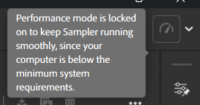

# Modus &quot;Niedrige Spezifikation&quot;

Wenn Ihre Hardware die [Mindestanforderungen](../getting-started/system-requirements.md) von Sampler nicht erfüllt, wird Sampler automatisch im Modus mit niedriger Spezifikation gestartet, der sich wie der [Leistungsmodus](performance-mode.md) verhält, ohne dass Sie die Einstellungen ändern können.

## Niedrige Spezifikationsmoduseinschränkungen

Der Modus mit niedriger Spezifikation aktiviert automatisch den **Leistungsmodus**, bei dem alle Funktionen deaktiviert sind und die maximale Vorschauauflösung 2048 × 2048 beträgt.

Der Modus mit niedriger Spezifikation deaktiviert:

* **Versatz**
* **Schatten**
* **Pfadverfolgung**

Darüber hinaus verhindert der Modus mit niedriger Spezifikation Exporte über 2048 px × 2048 px.

*Diese Meldung wird im **Exportfenster**angezeigt, während Sie sich im **Modus mit niedriger Spezifikation**befinden, um zusätzliche Informationen bereitzustellen.*

## Wie finde ich heraus, ob der Modus für niedrige Spezifikationen aktiviert ist?

Wenn Ihre Hardware beim Start von Sampler nicht die Mindestanforderungen erfüllt, wird ein Fenster angezeigt, in dem Sie auf die nicht erfüllten Anforderungen hingewiesen werden und in dem Sie die Möglichkeit haben, Sampler weiterhin zu starten.

Die folgende Abbildung zeigt ein Beispiel für einen Computer mit weniger als 8 GB VRAM.

Wenn Sie **Trotzdem starten** auswählen, wird Sampler im **Modus mit niedriger Spezifikation** gestartet. Wenn Sie das Kontrollkästchen in der obigen Meldung verwendet haben, um sie sowieso nicht anzuzeigen und zu starten, wird bei nachfolgenden Starts weiterhin das folgende Banner angezeigt.

Schließlich ist es nicht möglich, den Leistungsmodus zu deaktivieren oder die Einstellungen für den Leistungsmodus anzupassen, während der **Modus mit niedriger Spezifikation** aktiviert ist.

